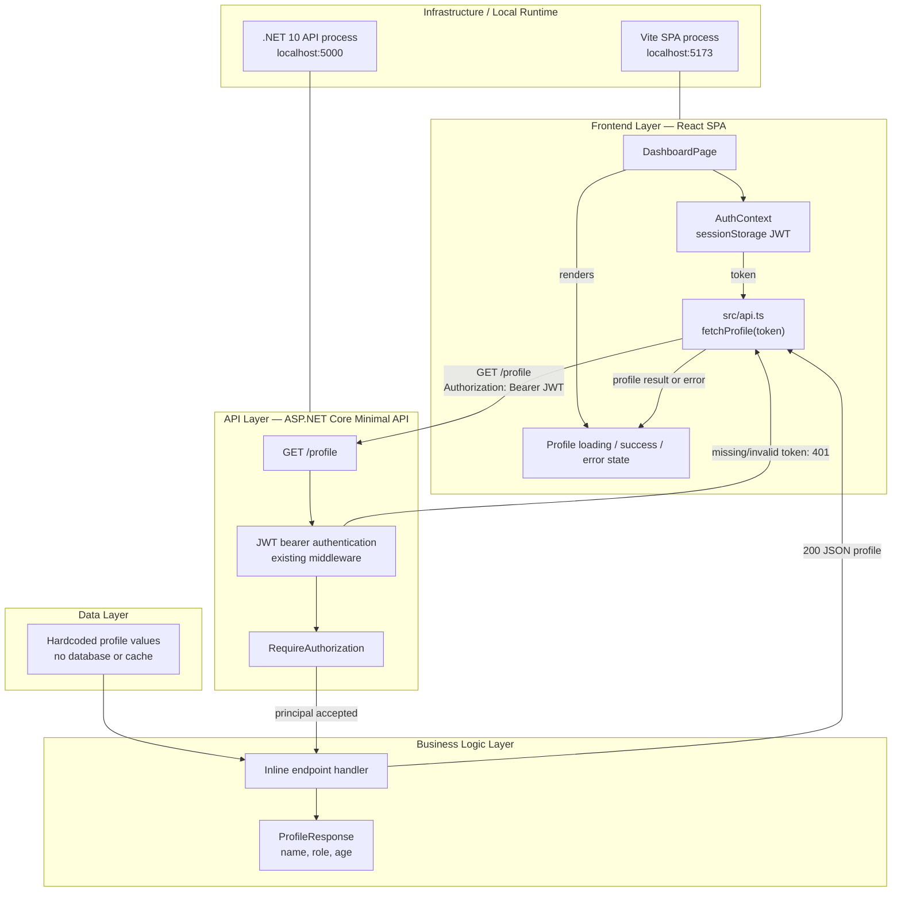
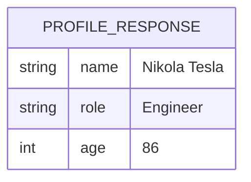
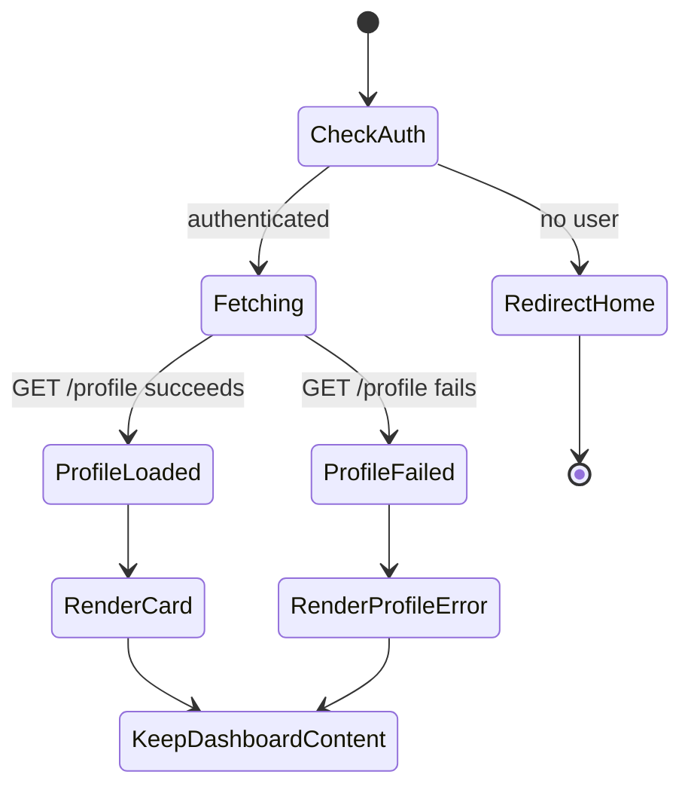

# Issue 60 - Profile Information Implementation Plan

## Source and Scope

- GitHub issue: [#60 - Add profile information](https://github.com/AI-SDLC-26/ai-sdlc-journey/issues/60)
- Repository: `AI-SDLC-26/ai-sdlc-journey`
- Scope: Add an authenticated, hardcoded profile endpoint and display its data on the existing authenticated dashboard.
- Out of scope: persistence, per-user profile data, profile editing, new auth providers, and new UI/component dependencies.

## Goal

Show a profile card on the dashboard for authenticated users. The API returns the same mock profile—Nikola Tesla, Engineer, age 86—for every valid JWT. The SPA fetches the profile independently of the existing demo data and shows an error in the profile area if that request fails, without hiding or breaking the rest of the dashboard. Unauthenticated users continue to be redirected away from the dashboard.

## Current Codebase Context

- `src/api/DemoApi/Program.cs` registers Minimal API endpoints inline, configures JWT bearer authentication, and protects `/api/demo` and `/api/users` with `.RequireAuthorization()`.
- API response records are declared at the bottom of `Program.cs`; API integration tests use `WebApplicationFactory<Program>` and obtain tokens through `/auth/login`.
- `src/spa/src/api.ts` contains the typed API functions and sends bearer tokens.
- `src/spa/src/pages/DashboardPage.tsx` redirects when `useAuth()` has no user and loads demo data in an effect. It currently renders demo items followed by the “Generated at:” timestamp.
- SPA tests use Vitest, React Testing Library, and mocked `fetch`; API tests use xUnit.
- The repository runs the API and SPA as separate local applications. There is no database, service layer, tRPC, Stack Auth, shadcn/ui, or container deployment configuration in the current feature path. The plan retains the existing stack and patterns.

## Requirements

### Functional Requirements

- Add `GET /profile` to the .NET API. Require the existing JWT bearer authentication.
- On a valid JWT, return HTTP 200 and JSON with `name: "Nikola Tesla"`, `role: "Engineer"`, and `age: 86`.
- Requests with no token or an invalid token receive HTTP 401.
- Add a typed SPA client function to request `/profile` with the current bearer token.
- On `/dashboard`, show a profile card with name, role, and age after the demo items and before the “Generated at:” timestamp.
- If the profile request fails, show an error in place of the card. Preserve the existing demo content and dashboard behavior.
- Preserve the current unauthenticated redirect from `/dashboard`; do not issue a profile request or show profile content for unauthenticated visitors.
- Add API and SPA tests for the endpoint, client, dashboard success/failure, and unauthenticated behavior.

### Constraints

- Keep profile values in-memory and hardcoded; do not introduce persistence or a profile service abstraction for this single mock response.
- Use the exact route `/profile` from the issue, not `/api/profile`.
- Use existing JWT validation and SPA session auth state; do not introduce Stack Auth or a new identity system.
- Keep the dashboard styling consistent with the existing simple inline-style approach. Use native HTML and existing dependencies.

## Technical Considerations

### System Architecture Overview



#### Technology Stack Selection

- **Frontend:** Keep React 19, TypeScript, React Router, and React Context. These are already used for the dashboard and authentication state.
- **API:** Keep ASP.NET Core 10 Minimal APIs and `System.Text.Json` serialization. Register the route inline in `Program.cs` and use the existing JWT bearer middleware.
- **Tests:** Use xUnit and `WebApplicationFactory<Program>` for API integration coverage; use Vitest and React Testing Library for SPA behavior.
- **Data:** Use a typed response record populated with fixed values. No database or cache is warranted for a deliberately static mock.

#### Integration Points

- SPA `fetchProfile(token)` calls `GET http://localhost:5000/profile` with `Authorization: Bearer <token>`, following the existing `src/api.ts` base URL and fetch conventions.
- The API route uses `.RequireAuthorization()` and the existing authentication pipeline. Do not duplicate token parsing or add a new authorization policy.
- JSON fields use the existing ASP.NET Core web defaults (camel case), matching the TypeScript profile interface.
- Profile state and error handling remain separate from demo-data state so the profile request cannot replace existing dashboard content on failure.

#### Deployment Architecture

- Continue running the API and SPA as separate local processes using the existing .NET and Vite commands.
- Do not add Dockerfiles, containers, deployment resources, environment variables, or infrastructure changes for this feature.

#### Scalability Considerations

- No scaling work is needed for fixed in-memory data in this local demo.
- If the profile becomes user-specific or persisted later, move profile retrieval behind an appropriate data/service boundary and consider caching only with user-aware cache keys and authorization-safe behavior. That future work is not part of this issue.

### Database Schema Design

No database schema or migration is required. The endpoint returns a transient response object and does not persist or query profile records.



The diagram represents the API response shape only, not a database table.

- **Table specifications:** None; no persisted tables.
- **Indexes and foreign keys:** None.
- **Migration strategy:** None. If persistence is introduced in a later feature, define and review its schema and migration strategy in that feature’s scope.

### API Design

#### `GET /profile`

- **Authentication:** JWT bearer token required through existing middleware and `.RequireAuthorization()`.
- **Success:** `200 OK`, JSON response:

  ```json
  {
    "name": "Nikola Tesla",
    "role": "Engineer",
    "age": 86
  }
  ```

- **TypeScript contract:**

  ```typescript
  export interface Profile {
    name: string;
    role: string;
    age: number;
  }
  ```

- **Errors:** `401 Unauthorized` for a missing or invalid/expired JWT, as enforced by the existing JWT bearer authentication setup. No custom error envelope is needed.
- **Rate limiting:** No endpoint-specific rate limiter is required for this local demo. Do not add global middleware as part of this change.
- **Caching:** No cache layer is needed. Avoid adding shared caching for this authenticated endpoint; if caching is introduced later, it must not leak user-specific data across principals.
- **OpenAPI:** Preserve the existing OpenAPI endpoint discovery and tag the route consistently with the API’s other Minimal API routes.

### Frontend Architecture

#### Component Hierarchy

```text
DashboardPage
├── Existing dashboard heading and navigation
├── Existing demo-data message and items
├── ProfileCard (render only when fetch succeeds)
│   ├── Profile name
│   ├── Profile role
│   └── Profile age
├── Profile request error (render instead of ProfileCard on failure)
└── Existing "Generated at:" timestamp
```

Place the profile result or error between the existing items list and timestamp. Keep the current authentication redirect and existing logout/navigation controls unchanged.

#### State Flow



- Continue using local React state in `DashboardPage`; a new state library is unnecessary.
- Track profile data and profile error independently from the existing demo data and error. The profile failure path must not clear or suppress a successful demo response.
- Call the profile API only when an authenticated user/token exists. Retain the component’s existing redirect behavior for no user.
- Render the profile card only after successful retrieval; render an error message instead if retrieval fails. A separate loading UI is not required by the issue.
- Use semantic headings and readable name/role/age labels. Keep visual treatment lightweight and accessible without introducing a component library.

#### API Client and Types

- Add a `Profile` interface to `src/spa/src/api.ts`.
- Add `fetchProfile(token: string): Promise<Profile>` that calls `/profile`, includes the bearer header, returns parsed JSON for a successful response, and rejects on a non-success response in line with existing API client behavior.

## Step-by-Step Implementation Plan

### 1. Add the authenticated profile endpoint

1. Define a small `ProfileResponse` record with `Name`, `Role`, and `Age` fields in `src/api/DemoApi/Program.cs`, following the current response-record convention.
2. Register `GET /profile` inline with the other endpoints and return the fixed profile response.
3. Apply `.RequireAuthorization()` and a suitable OpenAPI tag. Do not change global authentication configuration.

**Deliverable:** `GET /profile` returns the agreed hardcoded profile for authenticated requests.

### 2. Add API integration tests

1. Add profile endpoint tests in the existing API test project, following `UsersEndpointTests` conventions.
2. Verify a request without credentials receives 401.
3. Verify a malformed or otherwise invalid bearer token receives 401.
4. Log in using the existing test login flow, call `/profile` with the JWT, and verify 200 plus exact `name`, `role`, and `age` values and JSON types.

**Deliverable:** Integration coverage for authorization and response contract.

### 3. Add the SPA profile API contract

1. Add the `Profile` interface and `fetchProfile(token)` function in `src/spa/src/api.ts`.
2. Use the exact `/profile` URL and bearer-token header.
3. Reject failed HTTP responses with a clear profile-load error consistent with existing API client error handling.
4. Add API-client unit tests for successful deserialization, request URL/header, and failed response rejection.

**Deliverable:** Typed API client with isolated unit coverage.

### 4. Integrate profile loading into the dashboard

1. Add profile data and profile error state separately from the dashboard’s existing demo state.
2. When authenticated, request the profile alongside the existing dashboard data; do not make a request for unauthenticated users.
3. Render a simple profile card below the items list and above “Generated at:” on success.
4. Render a profile-specific error in that same position on failure, leaving other dashboard content intact.
5. Preserve the existing redirect, logout action, navigation link, and demo content behavior.

**Deliverable:** Authenticated dashboard displays profile data or an isolated error.

### 5. Add dashboard behavior tests

1. Update `DashboardPage.test.tsx` to mock both API requests explicitly.
2. Verify the profile card displays the exact name, role, and age after successful loading.
3. Verify a profile request failure shows an error, does not show the card, and does not suppress successful demo items or timestamp.
4. Verify an unauthenticated visitor is redirected and no profile request/card is rendered.
5. Ensure fetch mocks account for both independent requests and their ordering without relying on brittle incidental timing.

**Deliverable:** SPA coverage for profile success, failure isolation, and auth gating.

### 6. Validate the feature

1. Run API tests from `src/api/DemoApi.Tests`.
2. Run focused SPA tests for the API client and dashboard.
3. Run the SPA production build to verify TypeScript and bundling.
4. If the repository’s available local setup permits, smoke-test the API with no token, an invalid token, and the demo login token; then verify the dashboard displays the card and retains the dashboard when the profile request fails.

**Deliverable:** Passing targeted tests/build and confirmed endpoint/UI behavior.

## Acceptance Criteria Mapping

| Issue acceptance criterion | Planned coverage |
|---|---|
| Valid JWT receives 200 with Nikola Tesla, Engineer, age 86 | Steps 1-2 |
| Missing or invalid JWT receives 401 | Steps 1-2 |
| Dashboard shows card between items and timestamp | Steps 3-5 |
| Unauthenticated visitor cannot access dashboard or profile | Steps 4-5; API authorization tests |
| Profile failure shows an error while the rest of the dashboard works | Steps 4-5 |
